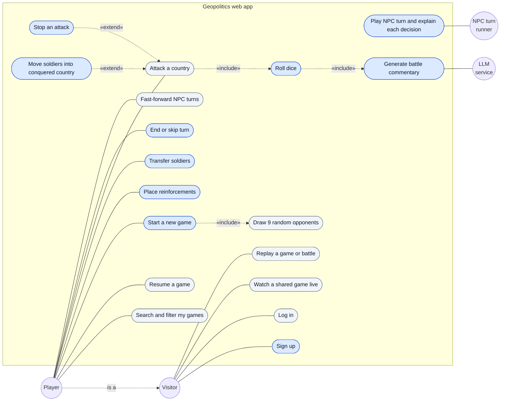
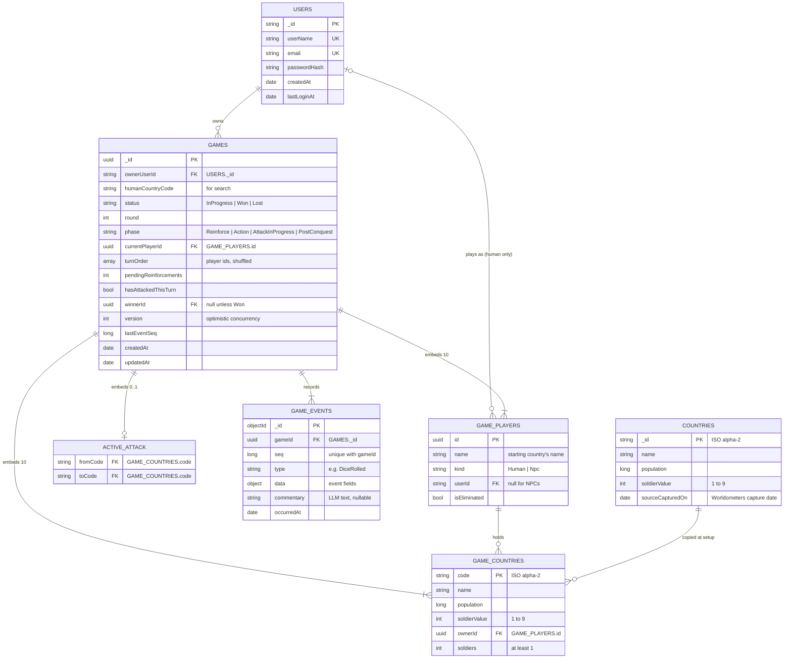

# Build plan

Deadline: Friday 6 November 2026.

| Dates | Phase | Done when |
|---|---|---|
| Sun 18 – Mon 19 Oct | Walking skeleton | Repo, solution projects, Atlas cluster, first deployment, ADR 0001 |
| Tue 20 – Fri 23 Oct | Domain engine and tests | Setup, soldier allocation, battles, conquest, reinforcement, elimination, win; all brief examples pass |
| Sat 24 – Sun 25 Oct | Persistence | Repositories, `gameEvents` log, version check, country seed data |
| Mon 26 – Tue 27 Oct | Auth and game lifecycle | Sign-up/login, start game, "my games" list with search and filter, public game page |
| Wed 28 – Fri 30 Oct | Real-time board and battle view | SignalR groups, all countries and soldier counts visible, dice animation, battle log |
| Sat 31 Oct – Mon 2 Nov | NPC AI | Turn loop, fast-forward, win-probability targeting, visible justifications |
| Tue 3 Nov | LLM commentary | Server-side calls, timeout, template fallback |
| Wed 4 Nov | Bonus and security | Battle replay and game history (bonus #5); security pass |
| Thu 5 Nov | Release prep | Test on deployed site, README, examiner Atlas access, source zip |
| Fri 6 Nov | Buffer | Submit to Amathuba |

## Persistence phase (Sat 24 – Sun 25 Oct)

### Decisions

- **Snapshot plus event log.** Each game is one document in `games` (the current board, loaded to play the next move)
  and an append-only log in `gameEvents` (the battle log, spectating and replay). Both are written in one MongoDB
  transaction, so a game is never saved without its events or the reverse.
- **Engine stays database-free.** The domain exposes a plain `GameState` via `game.ToState()` and `Game.Restore(state)`;
  Infrastructure maps it to and from BSON. `Restore` re-checks the invariants, so a corrupted document is rejected.
- **Optimistic concurrency.** A save succeeds only if the stored `version` still matches the one loaded; otherwise it
  fails with a `ConcurrencyException` and writes nothing. The unique `(gameId, seq)` index is a second safety net.
- **Playable countries.** The 195 sovereign states (193 UN members plus the observer states Vatican City and
  Palestine), with populations captured once from Worldometers into a committed `countries.json`. The running app
  never calls Worldometers.
- **Integration tests** run against MongoDB in a container via Testcontainers (Rancher Desktop locally, Docker on
  GitHub Actions), started as a single-node replica set so transactions work.

### Use case diagram

Actors outside the boundary, use cases inside. Blue use cases write to MongoDB (game snapshot and events, or a new
user); grey ones only read.

- A **Player** is a logged-in Visitor: they can do everything a visitor can, plus play their own games.
- The **NPC turn runner** is the server-side loop that plays NPC turns using the same moves as the player.
- **Stop an attack** and **Move soldiers into conquered country** extend an attack; they only happen during one.

### Database schema (ERD)

`USERS`, `GAMES`, `GAME_EVENTS` and `COUNTRIES` are MongoDB collections. `GAME_PLAYERS`, `GAME_COUNTRIES` and
`ACTIVE_ATTACK` are embedded inside each game document, because a game is always read and written as one unit
(the aggregate boundary). `USERS` is finalised in the authentication phase.

### Indexes

| Collection | Index | Purpose |
|---|---|---|
| `games` | `{ ownerUserId: 1, updatedAt: -1 }` | "My games" list, newest first |
| `games` | `{ status: 1, updatedAt: -1 }` | Filter by in progress / won / lost |
| `gameEvents` | `{ gameId: 1, seq: 1 }`, unique | Ordered replay; rejects a duplicate save |
| `countries` | `{ name: 1 }` | Searchable country picker |
| `users` | `{ userName: 1 }`, `{ email: 1 }`, both unique | Login and sign-up checks |

The app creates these indexes at startup, so a fresh database sets itself up.

### Event types

`GameStarted` (includes the starting board), `TurnStarted`, `ReinforcementsPlaced`, `SoldiersTransferred`,
`AttackStarted`, `DiceRolled` (actual dice values), `AttackFailed`, `AttackStopped`, `CountryConquered`,
`SoldiersMovedIn`, `PlayerEliminated`, `GameEnded`, `TurnEnded`. The NPC phase adds `NpcDecision`.

## Turn state machine

`Reinforce → Action → AttackInProgress → PostConquest → End`. Transfers are rejected during `AttackInProgress`.

## NPC strategy

Each pair of dice is fair (15/36 attacker, 15/36 defender, 6/36 tie), so the chance of conquest depends only on soldier
counts and can be precomputed. The NPC concentrates troops on one attack stack, targets the country with the best
win probability × conquest bonus (weighted toward eliminations and the leader), stops when win probability falls below
about 30%, and records a structured reason for every decision.
